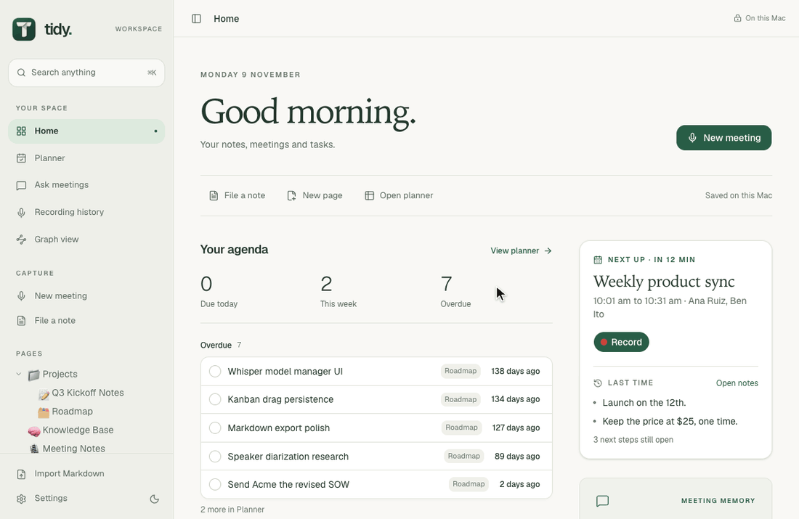
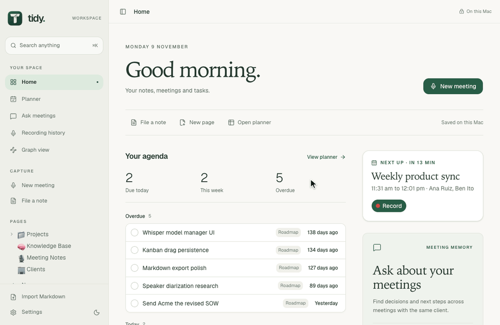
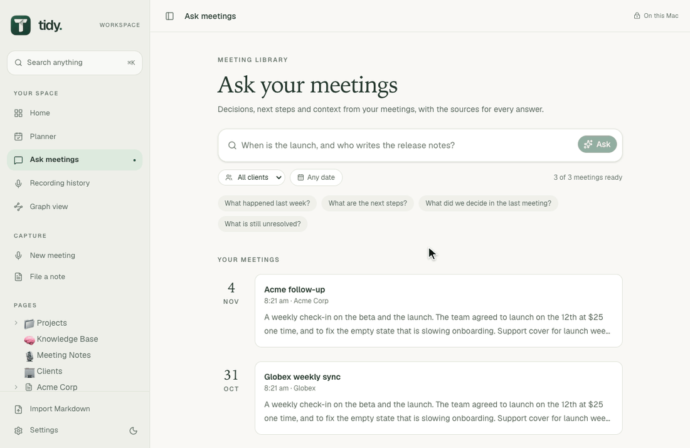
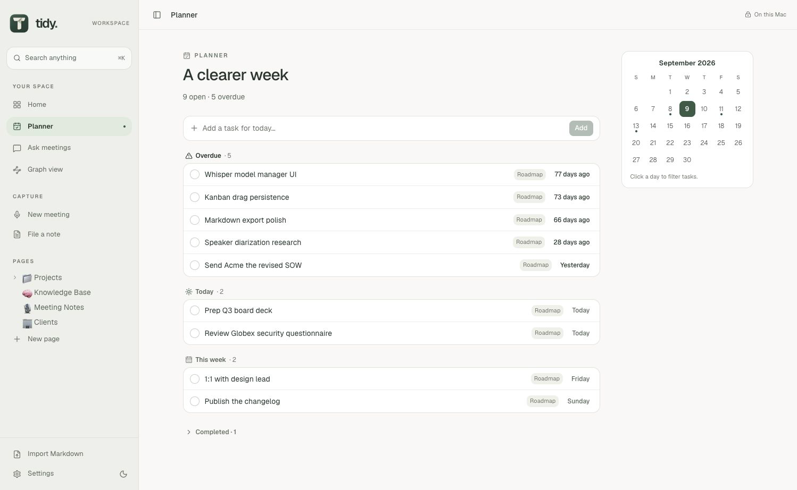
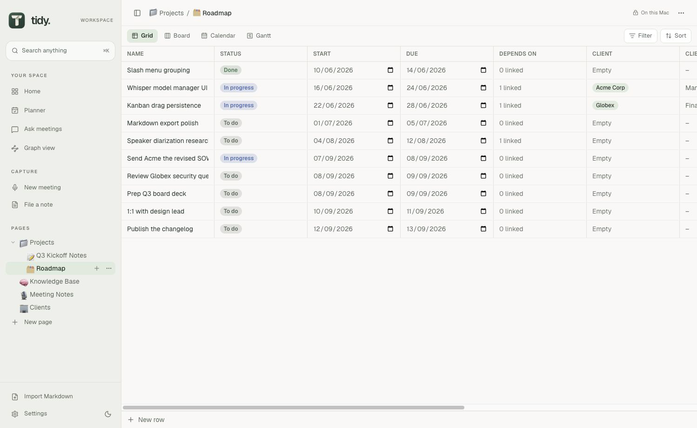
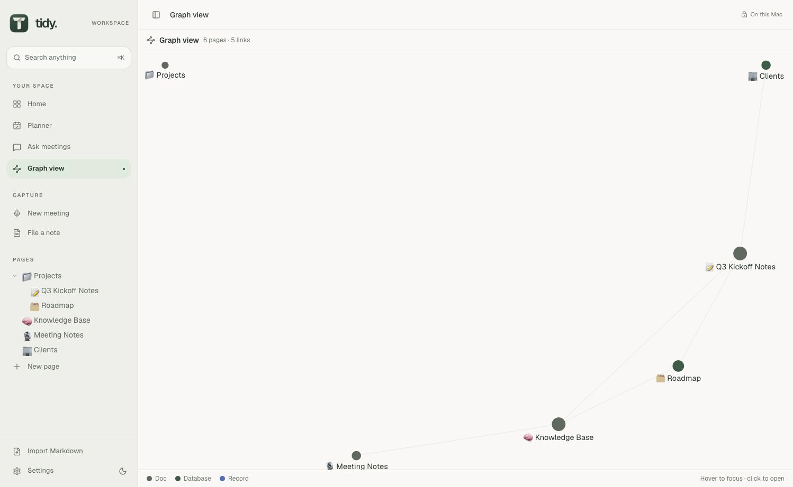

<p align="center">
  
</p>

<p align="center">
  Notes, tasks and meeting transcripts on your Mac.<br />
  Record calls, get checked notes and ask questions across each client's meetings.
</p>

<p align="center">
  <a href="https://github.com/REllwood/Tidy/releases/latest">Download for Apple Silicon</a> ·
  <a href="docs/LOCAL-AI.md">Local AI guide</a> ·
  <a href="docs/AI-QUALITY.md">AI quality checks</a>
</p>

<p align="center">
  
</p>

*Captured from an earlier browser preview with made-up sample data. Recording, model setup and AI answers in these demonstrations are simulated, and timings do not represent desktop performance. [Still images and capture details](docs/screenshots/README.md).*

## Meet Tidy

Tidy brings a block editor, daily planner, relational tables and meeting recorder into one Mac app. Notes link to pages, dated tasks appear in your agenda, and recordings become a searchable meeting library.

No Tidy account, subscription or telemetry. Your workspace lives on your Mac. Model downloads and update checks use an internet connection. Transcription and the built-in AI run on your Mac after setup.

## Install

Download the latest DMG from the [releases page](https://github.com/REllwood/Tidy/releases/latest), open it and drag **Tidy** into **Applications**.

| | Current release |
| --- | --- |
| Mac | Apple Silicon, M1 and newer |
| macOS | 14.4 or later |
| Distribution | Developer ID signed and notarised by Apple |
| Updates | Offered in the app from v0.3.0 onwards |

Each release page lists what changed and a SHA-256 checksum. Intel, Windows and Linux installers are not included.

Tidy checks for updates automatically, and you choose when to download, install and restart. Versions before v0.3.0 need to install the DMG once by hand. A new version can upgrade the workspace database the first time it opens, and earlier versions cannot open it after that. Existing notes, transcripts and pages stay in place.

## Recording a call

<p align="center">
  
</p>

- **Tidy offers to record.** When Zoom, Teams, FaceTime, Slack or a browser starts using the microphone, a small window asks whether to record and reminds you to tell everyone. Nothing records until you choose **Record**. Turn this off under **Settings → Recording → Offer to record calls**.
- **Both sides, kept apart.** Your microphone and the other side of the call are recorded separately. Your words are labelled **You**, and only the other side is split into speakers, so their voice coming back through your speakers is not transcribed as yours.
- **It stops by itself.** A recording stops when the call ends, after 3 minutes of silence, or 5 minutes after its calendar event ends. A 15-second countdown lets you choose **Keep recording**, and the meeting notes why it stopped.
- **Mark a moment.** Press **Control-Option-M** in any app, or **Mark moment**, and the moment is listed in the notes.
- **Help during the call.** A live transcript, **Recap so far**, and answers from past meetings without leaving the call.

Transcription runs on your Mac with Whisper. It skips silence, leaves out lines Whisper invents (such as "thanks for watching") and spells names the way you do, using the meeting's client, its invitees and **Settings → Recording → Names and terms**.

**Audio is off by default.** Turn on **Settings → Recording → Keep meeting audio** before a meeting if you want to play it back, export it or transcribe it again later. A temporary recording is kept until its transcript has been saved. [Recording history and recovery limits](docs/MEETING-RELIABILITY.md).

## From a conversation to useful notes

1. Open **New meeting** and choose an existing client or enter a new one, or let Tidy name the recording after its calendar event.
2. Record, then stop to transcribe on your Mac, with optional speaker labels.
3. With local AI enabled, Tidy reads the whole meeting and writes an overview, topic sections, decisions, next steps and open questions. Every point is checked against what was said when it was said: its names, numbers and the person given a task must be there. Points it cannot back up are left out.

Notes follow a layout chosen from the meeting title: 1:1, Standup, Customer call, Interview, Planning or Retro. **Rewrite notes as** changes it. Every note point shows when it was said. Click the time to jump to that line of the transcript and, when the audio was kept, to play from there.

Your transcript is saved before AI processing. If AI is disabled, it remains available and the meeting waits in the preparation queue. Editing the page keeps the notes, and they are only written again if the transcript itself changes.

From the meeting notes you can:

- **Name speakers**, so "Speaker 2" becomes "Priya" in the transcript, the notes and answers. Tidy works names out from the conversation, for example someone asked "What do you think, Tom?" who then answers. Clear ones are applied before the notes are written, and others are suggested, with lines from each speaker that you can play.
- **Add notes to page**, to put the notes above the transcript where exports, your vault and search include them.
- **Send next steps to planner**, to add them as dated tasks in a table you choose. Nothing is added unless you ask.

## Your calendar

Turn on **Settings → Calendar → Use my calendar** to name recordings after their event, suggest invitees as speaker names and, before a meeting, see what earlier meetings like it decided and left open. Tidy reads the calendar through macOS on your Mac, and only after you turn it on.

## Ask across the same client's meetings

<p align="center">
  
</p>

Choose a client in **Ask meetings**, optionally narrow the dates, and ask about their recordings together. You can also name them in the question: Tidy reads dates such as "last week" or "in March", a client's name, a meeting's title and "our last meeting", and says how it read the question. Reuse the same client when recording follow-ups so they belong to the same history.

Questions to try when the information is in your transcripts:

- “What happened last week?”
- “What are the next steps from our last meeting with Acme?”
- “Who is responsible for the client handover?”
- “What changed between the kickoff and the follow-up?”
- “What is still unresolved?”

Recaps and lists of decisions, next steps or open questions come from each meeting's checked notes, so they cover every meeting in range. Specific questions search transcript passages and your own pages by meaning. Answers link individual claims to their sources. When nothing can be backed up, Tidy shows the closest passages instead of guessing. The library displays ready, queued and failed meetings, with stage and passage progress while work runs.

AI can still miss context or get an inference wrong. Review the original sources for names, dates and commitments. Large-library answers may use a sample of the available material, and the displayed coverage makes that visible. Each question is independent. [How retrieval and verification work](docs/LOCAL-AI.md#retrieval-and-answer-limits).

## Local AI, without a separate app

In **Settings → Local AI**, choose **Enable local AI** to download the recommended answer model and meeting search model. Downloads have progress and cancellation controls, and you can choose another model or remove downloaded files in Settings.

| Model | Purpose | Approximate download |
| --- | --- | --- |
| Qwen 3 · Balanced | Meeting notes and answers | 2.5 GB |
| Qwen 3 · Lightweight | Lower-memory alternative | 639 MB |
| Nomic meeting search | Find related passages in meetings and pages | 146 MB |

The app bundles the inference runtime. **Ollama is optional**, available as an advanced provider. Models load one at a time, and background AI work pauses while you record, apart from the live help you ask for. A 16 GB Mac is offered the balanced model, but speed and memory pressure depend on the meeting and other open apps. [Setup, model licences and limits](docs/LOCAL-AI.md).

Transcription offers 12 Whisper models, including English-only models, Large V3, Turbo and compressed versions. Answers can use Qwen models from 0.6B to 32B. Settings shows download sizes, suggested RAM and filters for lower-memory, everyday and larger models. Suggestions do not stop you choosing another model. RAM guidance is an estimate, and the full range has not been benchmarked across Mac models. Larger models write more accurate notes but take longer.

## Keep the rest of your work close

<p align="center">
  
</p>

**A daily agenda and planner.** Home brings dated tasks together from your tables. Review overdue work, complete a task, reschedule it or add something to your week.

<p align="center">
  
</p>

**One dataset, four views.** Use a grid, board, calendar or Gantt chart. Relations, lookups, rollups and formulas keep related information together. Promote a row to a page when it needs more room.

<p align="center">
  
</p>

**Notes that connect.** Use headings, lists and to-dos in the block editor. Type `[[` to pick a page to link (or create one), `#` to pick a tag, follow backlinks, or explore the graph. **Ask AI** on any page summarises, rewrites or answers questions about it, long pages included.

## Your files and your tools

Tidy stores its workspace in local SQLite. An optional Markdown vault mirrors page content to a folder you choose, reads external edits back in and keeps conflicting edits in a separate copy. Meeting notes join the vault once you choose **Add notes to page**. **Export as Markdown** saves a page, or a table's rows, through the save dialog.

The bundled MCP server lets a connected tool such as Claude Code or Codex read and search the workspace. Writes require the token generated in Tidy Settings. Its `ingest_note` tool files raw text at once with the original wording kept, and Tidy's own local AI adds a checked summary and any tasks while Tidy is open, whichever model you have chosen. Connected agents can read your content, so their own data handling also applies. [MCP implementation](crates/mcp/src/main.rs).

## Run from source

Use Node.js 22.12+ with npm, Rust, Xcode command-line tools and CMake. The browser preview uses a mock backend and does not access your desktop workspace.

```bash
npm ci
npm run dev
```

For the native Mac app, build its bundled helpers first:

```bash
bash scripts/build-sidecar.sh
bash scripts/build-ai-runtime.sh
npm run tauri dev
```

Checks:

```bash
npm test
npm run build
cargo test --workspace --locked
```

The source passes 202 front-end, 110 shared-core and 104 native unit tests. Ignored tests check notes, answers, speaker labels and transcription against the real local models with made-up meetings. These checks are not a general accuracy benchmark. [Evaluation details](docs/AI-QUALITY.md).

Built with Tauri, React, TypeScript, SQLite, whisper.cpp, sherpa-onnx and llama.cpp. Distributed under AGPL-3.0-or-later. Maintainers can follow the [local signing and release guide](docs/RELEASING.md).
