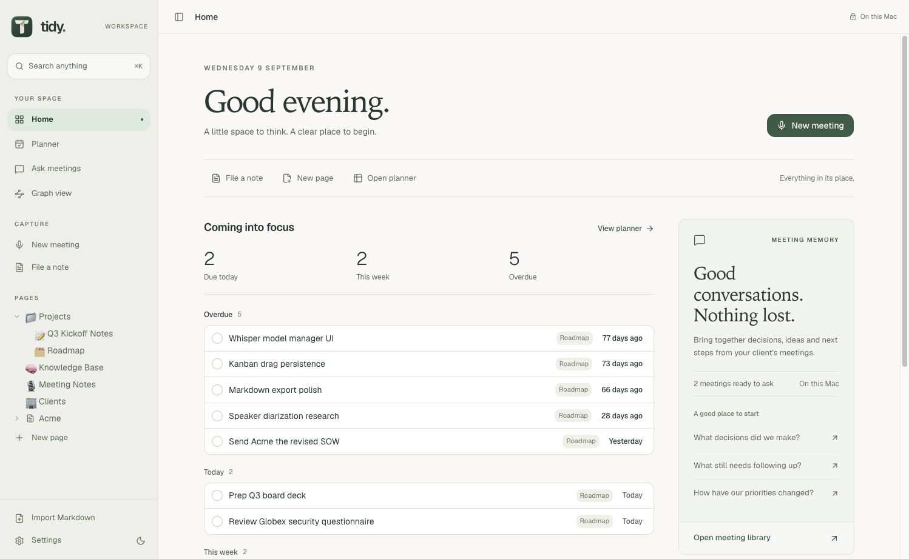
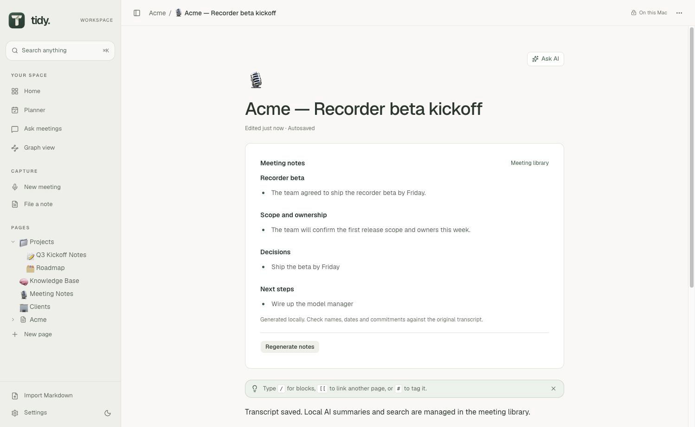
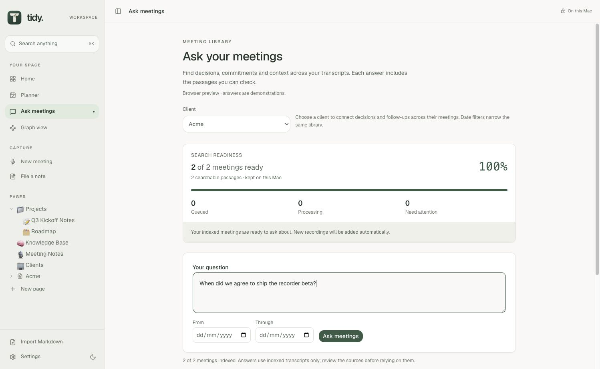
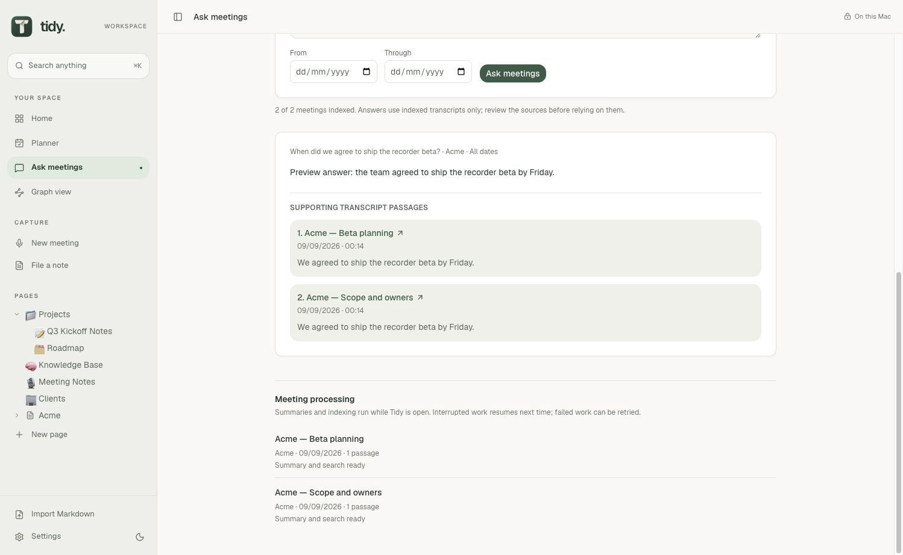
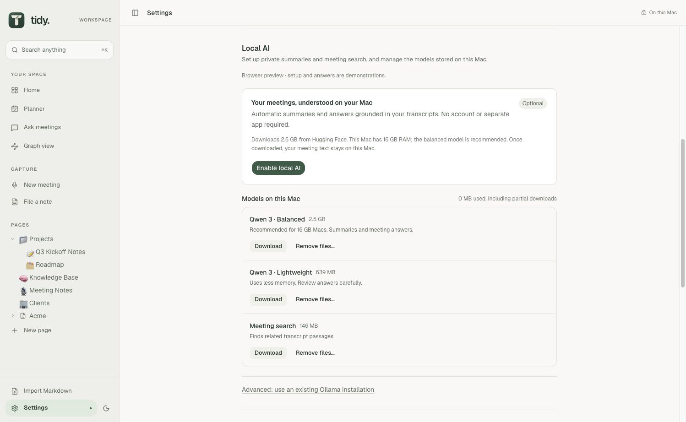
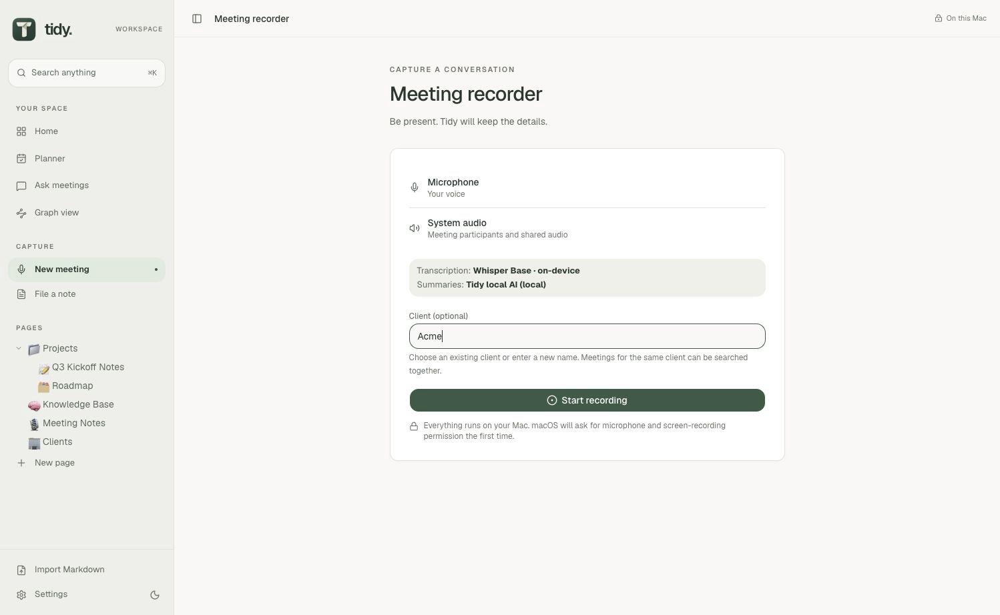
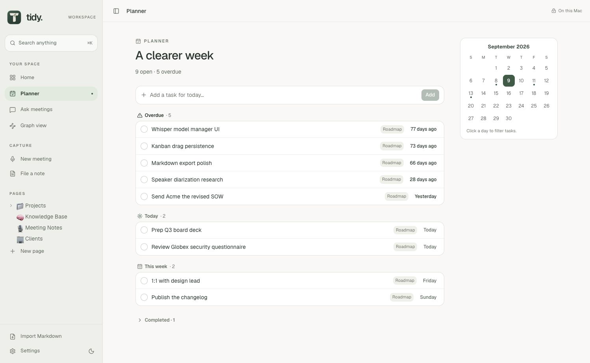
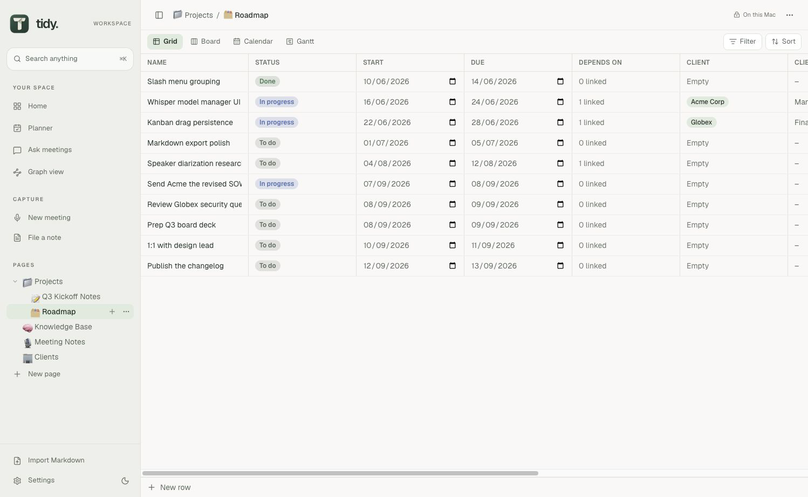
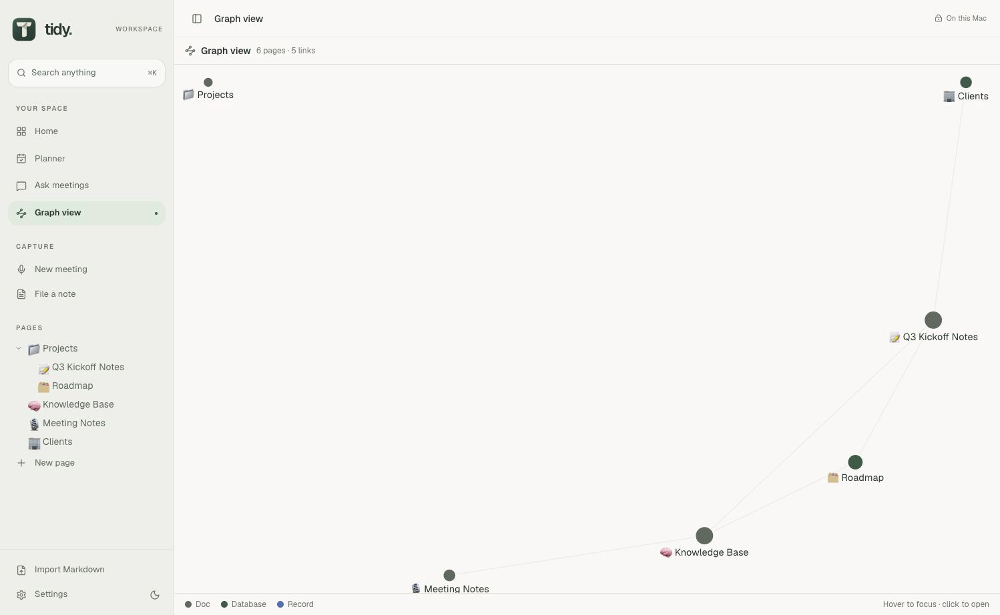

# Tidy examples

These captures use synthetic data in the browser preview. The still images were captured on 9 September 2026 from the v0.2.1 source, and the animations on 9 November 2026 from v0.6.0. No customer notes, recordings or credentials are included.

The browser preview simulates recording, transcription, model downloads and AI answers. The two Acme meetings use the same built-in sample transcript. They demonstrate client grouping and the source-review interface, not a live comparison of different conversations. Native model evaluation is documented separately in [AI quality checks](../AI-QUALITY.md).

## Walkthroughs

| Animation | What it shows |
| --- | --- |
| [Workspace tour](tour.gif) | Home with the next meeting, the planner, a roadmap as a table and a board, last week's notes with a next step ticked off, a question answered from a meeting, and dark mode |
| [Meeting capture](meeting.gif) | Recording the next calendar meeting, audio meters for each side, marking a moment, transcription and the finished notes |
| [Ask meetings](ask-meetings.gif) | Choosing Acme Corp, matching meetings as the question is typed, the answer and its two meeting sources |

Each animation is one continuous take with a drawn pointer. Its pace is not a measurement of recording, download or inference speed. There is no caption bar, so the note beneath the tour in the main README identifies the simulated preview. The preview does not name recordings after calendar events, so the recorded meeting was given its event's name, as the desktop app would. The preview's own demonstration labels were hidden while recording.

## Still images

### Home

### Structured meeting notes

### Meeting library

### Answer and sources

### Local AI setup

### Meeting recorder

### Planner

### Tables

### Graph

## Refreshing the examples

Run `npm ci` and `npm run dev`. Use a separate browser-preview session with synthetic data; never capture the user's native workspace for public documentation. Enable the simulated Local AI setup, record two preview meetings under the same client and open Ask meetings to capture the question and source-review flow. Capture loading states as well as completed screens.

Use browser screenshots for still images and convert the returned image bytes to genuine PNG files. Record animations with the browser's screencast and assemble them with FFmpeg at 1,100 pixels wide and ten frames per second, with palette optimisation. Preserve clear text and alt descriptions. Check every frame, internal documentation link and published image after updating.
